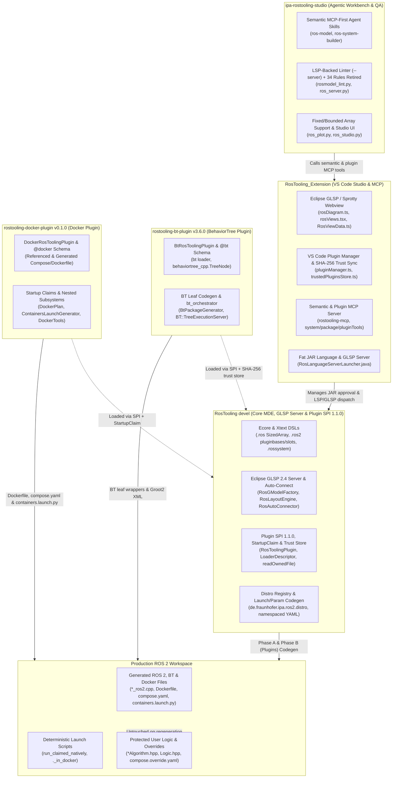

# RosTooling Ecosystem: Canonical Agent Knowledge Base & Architecture Reference

> [!NOTE]
> **Purpose of this Artifact**: This document serves as the canonical knowledge base and architectural reference for any AI agent (Antigravity subagent, Claude Code, Gemini CLI, or automated worker) interacting with the **RosTooling** ecosystem. It reflects the **2026-11-25** state across all **five** projects: **RosTooling (`devel`, Plugin API 1.1.0)**, **RosTooling_Extension (`esa/feature/fixed-size-arrays`)**, **ipa-rostooling-studio (`esa/feature/fixed-size-arrays`)**, **rostooling-bt-plugin (`3.6.0`)**, and the new **rostooling-docker-plugin (`0.1.0`)**.

---

## Canonical Repository Locations (Exclusive Usage Policy)

> [!CAUTION]
> **STRICT REPOSITORY LOCATION POLICY — ONLY USE THESE LOCATIONS**
> Agents MUST read, edit, build, test, and push **ONLY** within the canonical repository locations listed below.
> **Do NOT use** sibling worktrees, backups, or upstream forks present elsewhere on disk (specifically **exclude** `/home/adm-esa/ros-model-main/git/RosTooling-esa-main`, `/home/adm-esa/coresense-ws/src/ros-model`, `/home/adm-esa/coresense-ws/src/rostooling_extension_bck`, and `/home/adm-esa/coresense-ws/src/rostooling_lsp_extension`).

| Project | Canonical Local Path (Use ONLY this path) | Canonical Remote Repository (`git remote`) | Active Branches / Version |
| :--- | :--- | :--- | :--- |
| **`RosTooling`** | [`/home/adm-esa/ros-model-main/git/RosTooling`](file:///home/adm-esa/ros-model-main/git/RosTooling) | `origin`: `https://github.com/ipa-esa/RosTooling.git` | `devel` (`32f4a105`, `3.6.0` / Plugin API `1.1.0`)<br/>Base: `esa/main` (`3.5.0`) |
| **`RosTooling_Extension`** | [`/home/adm-esa/coresense-ws/src/RosTooling_Extension`](file:///home/adm-esa/coresense-ws/src/RosTooling_Extension) | `origin`: `https://github.com/ipa-esa/RosTooling_Extension.git`<br/>`upstream`: `git@github.com:ipa-esa/RosTooling_Extension.git` | `esa/feature/fixed-size-arrays` (`07ffaf7`)<br/>Base: `main` (`2.5.0`) |
| **`ipa-rostooling-studio`** | [`/home/adm-esa/coresense-ws/src/ipa-rostooling-studio`](file:///home/adm-esa/coresense-ws/src/ipa-rostooling-studio) | `origin`: `https://github.com/ipa-esa/ipa-rostooling-studio.git` | `esa/feature/fixed-size-arrays` (`6674706`)<br/>Base: `main` (`0.2.2`), `0.3.0` |
| **`rostooling-bt-plugin`** | [`/home/adm-esa/coresense-ws/src/rostooling-bt-plugin`](file:///home/adm-esa/coresense-ws/src/rostooling-bt-plugin) | *(Local repository; no remote configured yet)* | `esa/feature/plugin-architecture` (`c829a31`, `3.6.0`) |
| **`rostooling-docker-plugin`** | [`/home/adm-esa/coresense-ws/src/rostooling-docker-plugin`](file:///home/adm-esa/coresense-ws/src/rostooling-docker-plugin) | *(Local repository; no remote configured yet)* | `main` (`52986d7`, `0.1.0`, Plugin API `1.1.0`) |

---

## 1. Executive Summary & Ecosystem Vision

The **RosTooling Ecosystem** is a model-driven engineering (MDE), plugin-extensible, and agentic development framework created at Fraunhofer IPA for **ROS 2**. It solves four structural problems:
1. **Manual Plumbing**: Eliminates up to 70% of repetitive boilerplate (publishers, subscribers, services, actions, executors, parameter files, QoS policies, BehaviorTree leaf wrappers, and Dockerfiles/Compose setups).
2. **Fragile Integration**: Replaces unverified CLI/launch remapping strings with compile-time checked topology models (now including `T[N]`/`T[<=N]` fixed/bounded arrays and namespaced YAML parameter keys) and deterministic launch generation.
3. **Tangled Domain Logic**: Enforces strict separation between generated middleware/BT/container wrappers and protected user files (`*Algorithm.hpp`, `*_logic.py`, `<Leaf>Logic.hpp`, `compose.override.yaml`).
4. **Expertise Barrier & Unsafe Extensions**: Provides Eclipse GLSP graphical editing, semantic MCP authoring, receiver-driven auto-connect, SHA-256 trusted external plugin loading (`StartupClaim` / `run_claimed_natively`), and AI agent skills.

### The 5-Project Architecture



---

## 2. Graphify Knowledge Graph Insights

Cross-repository `/graphify` analysis (updated **2026-11-25**) covers **33,838 nodes**, **99,697 edges**, and **1,247 communities** across all **five** projects:

| Repository | Canonical Local Path | Commit / Active Branch | Nodes | Edges | Communities | Extraction Fidelity |
| :--- | :--- | :--- | :--- | :--- | :--- | :--- |
| **`RosTooling`** | [`/home/adm-esa/ros-model-main/git/RosTooling`](file:///home/adm-esa/ros-model-main/git/RosTooling) | `32f4a105` (`devel`) | 28,945 | 89,266 | 865 | 80% Extracted, 20% Inferred |
| **`RosTooling_Extension`** | [`/home/adm-esa/coresense-ws/src/RosTooling_Extension`](file:///home/adm-esa/coresense-ws/src/RosTooling_Extension) | `07ffaf77` (`esa/feature/fixed-size-arrays`) | 1,367 | 2,718 | 96 | 95% Extracted, 5% Inferred |
| **`ipa-rostooling-studio`** | [`/home/adm-esa/coresense-ws/src/ipa-rostooling-studio`](file:///home/adm-esa/coresense-ws/src/ipa-rostooling-studio) | `6674706a` (`esa/feature/fixed-size-arrays`) | 1,606 | 3,842 | 180 | 96% Extracted, 4% Inferred |
| **`rostooling-bt-plugin`** | [`/home/adm-esa/coresense-ws/src/rostooling-bt-plugin`](file:///home/adm-esa/coresense-ws/src/rostooling-bt-plugin) | `c829a31a` (`esa/feature/plugin-architecture`) | 1,133 | 1,650 | 84 | 99% Extracted, 1% Inferred |
| **`rostooling-docker-plugin`** | [`/home/adm-esa/coresense-ws/src/rostooling-docker-plugin`](file:///home/adm-esa/coresense-ws/src/rostooling-docker-plugin) | `52986d7` (`main`) | 787 | 2,221 | 22 | 95% Extracted, 5% Inferred |
| **Total Ecosystem** | — | — | **33,838** | **99,697** | **1,247** | **High Confidence (~0.86)** |

### 2.1 Core Architectural Hubs ("God Nodes")

#### `RosTooling` (Core Metamodels, DSLs, GLSP, Distro Registry & Plugin SPI)
- **`InternalRos2Parser`** (2,172 edges) / **`InternalRos1Parser`** (1,533 edges) / **`InternalRosParser`** (1,455 edges) / **`InternalRosSystemParser`** (1,191 edges) / **`InternalBasicsParser`** (708 edges): Generated Xtext/ANTLR parsers forming the structural backbone of all 4 DSLs (now incorporating `primitives.SizedArray` fixed/bounded arrays `T[N]`/`T[<=N]` and `pluginbases:`/`pluginslots:`/`slots:` rules).
- **`BasicsGrammarAccess`** (337 edges) / **`RosPackage`** (324 edges) / **`Ros2SyntacticSequencer`** (322 edges) / **`RosGrammarAccess`** (310 edges) / **`Ros2GrammarAccess`** (301 edges).
- **`RosToolingPlugin`**, **`StartupClaim`**, **`LoaderDescriptor`**, **`PluginRegistry`**, **`ExtensionSchemaMapper`**, **`GenerationContext`** (`de.fraunhofer.ipa.ros.plugin.spi`): Plugin API `1.1.0` contract, `run_claimed_natively` start-up claim coordination, SHA-256 JAR trust store, `readOwnedFile(...)`, and two-phase ownership isolation.

#### `RosTooling_Extension` (VS Code Studio, Plugin Manager & MCP Server)
- **`GlspClientBridge`** (41 edges) / **`activate()`** (33 edges) / **`VsCodePluginHost`** (32 edges) / **`PluginHostAdapter`** (30 edges): Primary GLSP bridge, Explorer Plugin Manager, and core SHA-256 trust delegation.
- **`RosCatalogueManager`** (25 edges) / **`HeadlessLspClient`** (25 edges) / **`summarizeMarkers()`** (24 edges) / **`commitModel()`** (23 edges) / **`runOperation()`** (23 edges) / **`editProperty()`** (22 edges): Includes sized array field handling in studio views and explicit error reporting for rejected `createNode` actions; `readViewData()` bridges (`0.089` betweenness) `extension.ts`, webview, and Xtext validation.

#### `ipa-rostooling-studio` (Agentic Workbench & QA)
- **`Linter`** (`scripts/rosmodel_lint.py`), **`StudioStore`**, **`action()`**, **`changed()`**, **`fail()`**, **`is_scalar()`**, **`RuntimeFailure`**, **`useStudio()`**: Supports fixed/bounded arrays (`T[N]`, `T[<=N]`), Phase 4 plugins, `RM098` launch substitutions, and optional `--server` Xtext validation after retiring 34 redundant rules.

#### `rostooling-bt-plugin` (BehaviorTree.CPP v4 / BehaviorTree.ROS2 Plugin)
- **`BtTools`** (44 edges), **`LeafModel`** (30), **`BtPackageGenerator`** (28), **`BtRosToolingPluginTest`** (18), **`BtRosToolingPlugin`** (13), **`BtGoldenGenerationTest`** (13), **`BtTypeMapper`** (13), **`BtSchema`** (9).

#### `rostooling-docker-plugin` (Containerization & Compose Orchestration Plugin)
- **`DockerTools`** (62 edges — *#1 God Node*, betweenness `0.062`): Exposes `docker_set_node`, `docker_set_system`, `docker_set_build`, and `docker_import` across MCP, schema blocks, and workspace test fixtures.
- **`DockerPluginTest`** (38 edges), **`DockerChecksTest`** (33), **`DockerToolsTest`** (33), **`DockerImportTest`** (32), **`NodeLaunchRenderer`** (28), **`SubsystemsWorkspaceTest`** (28), **`GeneratedMode`** (23), **`DockerRosToolingPlugin`** (22), **`DockerPlan`** (21).

---

## 3. Deep Dive into the Five Projects

### Project 1: `RosTooling` (`devel`, Plugin API `1.1.0` — Core MDE, GLSP Server & Plugin SPI)
- **Canonical Path**: [`/home/adm-esa/ros-model-main/git/RosTooling`](file:///home/adm-esa/ros-model-main/git/RosTooling)
- **Key Recent Additions (`devel`) & Subsystems**:
  1. **Fixed-Size & Bounded Arrays (`primitives.SizedArray`)**: `.ros` message specs accept `T[N]` and `T[<=N]` for primitives, `time`, `duration`, `Header`, and message references; `[` and `]` lex as separate tokens (allowing spaced brackets and `[]` / `[ ]`), rejecting sizes `< 1` and nested arrays.
  2. **Catalogue, Parameter & Launch Fixes**: `0b...` Base64 literals; packages indexed by own name for `dependencies:`; `RosCatalogueResolver` multi-package `.ros` indexing & `createNode` catalogue lookup; system-level parameter `default:` fallback in launch/README; namespaced node parameter files load `config/<ns>_<name>.yaml` keyed by qualified name (`/ns/node:`).
  3. **Plugin SPI `1.1.0` (`de.fraunhofer.ipa.ros.plugin.spi`)**: Adds **`StartupClaim`** + generic **`run_claimed_natively`** launch argument (turning every claimed switch off unless overridden per-element), `LoaderDescriptor`, `@<block>:` schema blocks, SHA-256 trust store + passive `META-INF/rostooling-plugin.properties` discovery, `GenerationContext.readOwnedFile(...)`, and `coreOwnedPaths()`.

### Project 2: `RosTooling_Extension` (`esa/feature/fixed-size-arrays` — VS Code Studio, Plugin Manager & MCP)
- **Canonical Path**: [`/home/adm-esa/coresense-ws/src/RosTooling_Extension`](file:///home/adm-esa/coresense-ws/src/RosTooling_Extension)
- **Key Architecture**: Bundles core Xtext + GLSP into `RosLanguageServerLauncher`, provides Sprotty/React 19 custom editors (`RosViewData.ts`, `GlspClientBridge.ts`), handles sized array fields in views, surfaces rejected `createNode` errors explicitly, manages SHA-256 plugin trust (`src/plugins/`), and serves `rostooling-mcp` (`pluginTools.ts`, `ros2_add_plugin_base`, `ros_auto_connect`).

### Project 3: `ipa-rostooling-studio` (`esa/feature/fixed-size-arrays` — Agentic Workbench & QA)
- **Canonical Path**: [`/home/adm-esa/coresense-ws/src/ipa-rostooling-studio`](file:///home/adm-esa/coresense-ws/src/ipa-rostooling-studio)
- **Key Responsibilities**: Semantic MCP-first agent skills updated for fixed/bounded arrays (preserving `T[N]`/`T[<=N]` and spaced `[` syntax) and Phase 4 plugins, LSP-backed `--server` linter (`rosmodel_lint.py` + `ros_server.py`, 34 redundant rules retired), `ros_plot.py`, and `ros_studio.py`.

### Project 4: `rostooling-bt-plugin` (`de.fraunhofer.ipa.ros.plugin.bt`, `3.6.0` — BehaviorTree Plugin)
- **Canonical Path**: [`/home/adm-esa/coresense-ws/src/rostooling-bt-plugin`](file:///home/adm-esa/coresense-ws/src/rostooling-bt-plugin)
- **Key Capabilities**: Registers the `bt` loader (`behaviortree_cpp.TreeNode`), `@bt:` schema (`kind`, `wraps`, `ports`), `BtPackageGenerator` (`<Leaf>Ports.hpp`, protected `<Leaf>Logic.hpp`, `<Leaf>BtNode.hpp`, Groot2 XML), `BtTools` MCP tools, and prebuilt `bt_orchestrator` (`BT::TreeExecutionServer` with `bt_leaves` slot). Verified on Humble, Jazzy, Kilted, Lyrical (Rolling blocked upstream in `BehaviorTree.ROS2`).

### Project 5: `rostooling-docker-plugin` (`de.fraunhofer.ipa.ros.plugin.docker`, `0.1.0` — Docker Plugin)
- **Canonical Path**: [`/home/adm-esa/coresense-ws/src/rostooling-docker-plugin`](file:///home/adm-esa/coresense-ws/src/rostooling-docker-plugin)
- **Build & Enable**: `mvn -o test package` → `target/rostooling-docker-plugin-0.1.0.jar` (`pluginApiVersionRange=[1.1.0,2.0.0)`). Enable with `--plugins-dir .../rostooling-docker-plugin-0.1.0.jar --enable-plugins de.fraunhofer.ipa.ros.plugin.docker`.
- **Key Capabilities**:
  1. **`@docker:` Block Schema (`DockerSchema`, `DockerValidator`, `DockerChecks`)**:
     - `.rossystem` system level (`enabled`, `compose`, `env_file`) claims every node instance; node-instance level (`enabled`, `compose`, `service`, `service_name`) refines or claims individual instances.
     - `.ros2` node level (`image`, `base_image` default `ros:<distro>`, `apt`, `env` list of `KEY=value`) provides package image build metadata (merged across nodes of a package).
     - Enforces error/warning checks (`docker.compose_requires_service`, `docker.duplicate_service`, `docker.duplicate_subsystem`, `docker.invalid_env`, `docker.service_name_clash`, `docker.env_pin_inconsistent`, `docker.package_conflict`, `docker.field_not_applicable`).
  2. **Referenced vs. Generated Mode**:
     - *Referenced Mode*: Emits only `launch/de_fraunhofer_ipa_ros_plugin_docker/containers.launch.py`, launching services from user-owned `<ROS_WS_SRC>/<compose>` (`up <service>` / `stop <service>`, or whole-project `up`/`down`) behind `<system>.<node>_in_docker`. Never reads or modifies user compose files.
     - *Generated Mode (`GeneratedMode`, `NodeLaunchRenderer`, `ContainersLaunchGenerator`)*: Writes `<pkg>/docker/Dockerfile` (`generatePackage`), `<sys>/config/de_fraunhofer_ipa_ros_plugin_docker/compose.yaml`, `<sys>/config/.../launch/<instance>.launch.py` (parity checked against host launch via AST comparator `compare_node_launch.py`), and `containers.launch.py` (`FASTDDS_BUILTIN_TRANSPORTS=UDPv4` set for root/non-root host discovery). User-owned **`compose.override.yaml`** is never touched and auto-appended with `-f` at launch when present.
  3. **Start-Up Claims & Nested Subsystems (`DockerPlan`, `StartupClaim`)**:
     - Claim switches use `<system>.<element>_in_docker` (system-qualified) plus core's `run_claimed_natively:=true` fallback.
     - Claimed subsystems are flattened under `subsystems/<name>/` and listed in the root `compose.yaml` via Compose `include:` (so relative contexts `${ROS_WS_SRC:-../../../../..}/<pkg>` resolve from isolated `share/<root>` install space). Nested switched-off nodes/subsystems launch natively from the subsystem's own launch file (scoped) so downstream sibling claims continue working.
  4. **Bottom-Up MCP Importer Tools (`DockerTools`)**:
     - Registers `de_fraunhofer_ipa_ros_plugin_docker__docker_set_node`, `docker_set_system`, `docker_set_build`, and `docker_import`.
     - `docker_import` consumes version-1 JSON output from an external Docker scanner script (referenced in `README.md` as `extract_docker.py`, passed via `-Drostooling.scanner=<path>` in tests when external), matches services to `.rossystem` node instances by `ros_args.node_name` or `(package, executable)`, writes `@docker:` blocks idempotently, and emits `.ros2` build `suggestions`.

---

## 4. The Domain Logic & User-Owned Override Shield

> [!IMPORTANT]
> **The Golden Architecture Invariant**: Custom robotics logic, BT leaf implementations, and hand-authored Docker Compose overrides MUST NEVER be overwritten during regeneration.

- **Regenerated Wrappers**: `NodeName_ros2.cpp` / `.py`, BT `<Leaf>Ports.hpp` / `<Leaf>BtNode.hpp`, Docker `<pkg>/docker/Dockerfile`, `config/de_fraunhofer_ipa_ros_plugin_docker/compose.yaml`, `containers.launch.py`, launch files.
- **Protected User Files *(never overwritten or mutated once created)***: `*Algorithm.hpp`, `*_logic.py`, BT `<Leaf>Logic.hpp`, user `compose.yaml` (referenced mode), and `compose.override.yaml` (generated mode).

---

## 5. Pre-Flight Checklist: The 12 RosTooling Syntax Rules

*(Prefer semantic MCP tools `rostooling-mcp` + `<plugin>__set_<block>` / `BtTools` / `DockerTools` when authoring; apply these rules whenever inspecting or editing raw DSL text.)*

| # | Rule Category | Strict Requirement |
| :--- | :--- | :--- |
| **1** | **Package & Node Names** | Identifiers must be **unquoted** alphanumeric/underscores. |
| **2** | **String Literals** | Message types, paths, and string values (including `Docker` `env` `"KEY=val"`) must be **double-quoted**. |
| **3** | **Booleans** | Lowercase literal `true` or `false` (never quoted). |
| **4** | **Floating Point Doubles** | Explicit decimal point required (`1.0`, not `1`). |
| **5** | **Connection Member Order** | In `.rossystem`, `from` must precede `to` (`from: ( ... ) to: ( ... )`). |
| **6** | **Artifact & Array Rules** | `.ros` allows `T[N]`/`T[<=N]` (size $\ge 1$, no nested arrays); `.ros2` separates `node:` vs `plugins:`. |
| **7** | **Parameter Typing** | Explicit type keyword (`String`, `Integer`, `Double`, `Boolean`, `Base64` incl. `0b…`, `Array`). |
| **8** | **Topic Names** | Clean ROS 2 graph resource names (no double slashes `//`). |
| **9** | **Remap Target Scope** | Targets must resolve to valid ports (`sub::node::iface` for nested subsystems). |
| **10** | **Substitution Syntax** | Balanced `$(var ...)`, `$(env ...)`, `$(find-pkg-share ...)` (checked by `RM098`). |
| **11** | **Interface References** | Valid imported specs (`pkg.msg`/`srv`/`action`) or `@<block>:` typed refs (`ac->`, `sc->`, `pub->`, `sub->`). |
| **12** | **File Termination** | End `.ros`, `.ros2`, and `.rossystem` files with a trailing newline. |

---

## 6. Agent Execution Playbook & Verification Commands

```bash
# 1. Enable BT and/or Docker plugins in rostooling-mcp (after SHA-256 trust approval)
rostooling-mcp \
  --plugins-dir /home/adm-esa/coresense-ws/src/rostooling-docker-plugin/target/rostooling-docker-plugin-0.1.0.jar \
  --enable-plugins de.fraunhofer.ipa.ros.plugin.docker

# 2. Build & test rostooling-docker-plugin (offline with RosTooling 3.6.0 / API 1.1.0 in ~/.m2)
cd /home/adm-esa/coresense-ws/src/rostooling-docker-plugin && mvn -o test package

# 3. Build & test rostooling-bt-plugin JAR
cd /home/adm-esa/coresense-ws/src/rostooling-bt-plugin && mvn test package

# 4. Linter (style/provenance/generator checks + optional --server LSP check) & HTML visualization
python3 /home/adm-esa/coresense-ws/src/ipa-rostooling-studio/scripts/rosmodel_lint.py --server auto /path/to/system.rossystem
python3 /home/adm-esa/coresense-ws/src/ipa-rostooling-studio/scripts/ros_plot.py /path/to/system.rossystem --out /tmp/system_plot.html

# 5. Build RosTooling_Extension fat JAR + VS Code extension + frontend
cd /home/adm-esa/coresense-ws/src/RosTooling_Extension && ./gradlew shadowJar && cd rostooling-languages && npm run compile
```

---

## 7. Key File Registry (Canonical Paths Only)

- **`RosTooling`** ([`/home/adm-esa/ros-model-main/git/RosTooling`](file:///home/adm-esa/ros-model-main/git/RosTooling)):
  - Metamodels & Grammars: [`ros.ecore`](file:///home/adm-esa/ros-model-main/git/RosTooling/plugins/de.fraunhofer.ipa.ros/model/ros.ecore), [`rossystem.ecore`](file:///home/adm-esa/ros-model-main/git/RosTooling/plugins/de.fraunhofer.ipa.rossystem/model/rossystem.ecore), [`Ros2.xtext`](file:///home/adm-esa/ros-model-main/git/RosTooling/plugins/de.fraunhofer.ipa.ros2.xtext/src/de/fraunhofer/ipa/ros2/Ros2.xtext), [`RosSystem.xtext`](file:///home/adm-esa/ros-model-main/git/RosTooling/plugins/de.fraunhofer.ipa.rossystem.xtext/src/de/fraunhofer/ipa/rossystem/RosSystem.xtext)
  - Plugin SPI & Trust (`1.1.0`): [`RosToolingPlugin.java`](file:///home/adm-esa/ros-model-main/git/RosTooling/plugins/de.fraunhofer.ipa.ros/src/de/fraunhofer/ipa/ros/plugin/spi/RosToolingPlugin.java), [`LoaderDescriptor.java`](file:///home/adm-esa/ros-model-main/git/RosTooling/plugins/de.fraunhofer.ipa.ros/src/de/fraunhofer/ipa/ros/plugin/spi/LoaderDescriptor.java), [`StartupClaim.java`](file:///home/adm-esa/ros-model-main/git/RosTooling/plugins/de.fraunhofer.ipa.ros/src/de/fraunhofer/ipa/ros/plugin/spi/StartupClaim.java), [`PluginRegistry.java`](file:///home/adm-esa/ros-model-main/git/RosTooling/plugins/de.fraunhofer.ipa.ros/src/de/fraunhofer/ipa/ros/plugin/spi/PluginRegistry.java), [`GenerationContext.java`](file:///home/adm-esa/ros-model-main/git/RosTooling/plugins/de.fraunhofer.ipa.ros/src/de/fraunhofer/ipa/ros/plugin/spi/GenerationContext.java)
  - GLSP & Distro Registry: [`RosGModelFactory.java`](file:///home/adm-esa/ros-model-main/git/RosTooling/plugins/de.fraunhofer.ipa.ros.glsp/src/main/java/de/fraunhofer/ipa/ros/glsp/model/RosGModelFactory.java), [`RosAutoConnector.java`](file:///home/adm-esa/ros-model-main/git/RosTooling/plugins/de.fraunhofer.ipa.ros.glsp/src/main/java/de/fraunhofer/ipa/ros/glsp/connect/RosAutoConnector.java), [`de.fraunhofer.ipa.ros2.distro`](file:///home/adm-esa/ros-model-main/git/RosTooling/plugins/de.fraunhofer.ipa.ros2.distro)
- **`RosTooling_Extension`** ([`/home/adm-esa/coresense-ws/src/RosTooling_Extension`](file:///home/adm-esa/coresense-ws/src/RosTooling_Extension)):
  - LSP/GLSP & Custom Editor: [`RosLanguageServerLauncher.java`](file:///home/adm-esa/coresense-ws/src/RosTooling_Extension/src/main/java/de/fraunhofer/ipa/ros/lsp/RosLanguageServerLauncher.java), [`extension.ts`](file:///home/adm-esa/coresense-ws/src/RosTooling_Extension/rostooling-languages/src/extension.ts), [`RosCustomEditorProvider.ts`](file:///home/adm-esa/coresense-ws/src/RosTooling_Extension/rostooling-languages/src/editor/RosCustomEditorProvider.ts), [`GlspClientBridge.ts`](file:///home/adm-esa/coresense-ws/src/RosTooling_Extension/rostooling-languages/src/glsp/GlspClientBridge.ts), [`RosViewData.ts`](file:///home/adm-esa/coresense-ws/src/RosTooling_Extension/rostooling-languages/src/glsp/RosViewData.ts)
  - Plugin Manager & MCP: [`pluginManager.ts`](file:///home/adm-esa/coresense-ws/src/RosTooling_Extension/rostooling-languages/src/plugins/pluginManager.ts), [`trustedPluginsStore.ts`](file:///home/adm-esa/coresense-ws/src/RosTooling_Extension/rostooling-languages/src/plugins/trustedPluginsStore.ts), [`rostooling-mcp.js`](file:///home/adm-esa/coresense-ws/src/RosTooling_Extension/rostooling-languages/bin/rostooling-mcp.js), [`pluginTools.ts`](file:///home/adm-esa/coresense-ws/src/RosTooling_Extension/rostooling-languages/src/mcp/pluginTools.ts)
- **`ipa-rostooling-studio`** ([`/home/adm-esa/coresense-ws/src/ipa-rostooling-studio`](file:///home/adm-esa/coresense-ws/src/ipa-rostooling-studio)):
  - Skills & QA: [`ros-model/SKILL.md`](file:///home/adm-esa/coresense-ws/src/ipa-rostooling-studio/.agents/skills/ros-model/SKILL.md), [`rosmodel_lint.py`](file:///home/adm-esa/coresense-ws/src/ipa-rostooling-studio/scripts/rosmodel_lint.py), [`ros_server.py`](file:///home/adm-esa/coresense-ws/src/ipa-rostooling-studio/scripts/ros_server.py), [`ros_plot.py`](file:///home/adm-esa/coresense-ws/src/ipa-rostooling-studio/scripts/ros_plot.py)
- **`rostooling-bt-plugin`** ([`/home/adm-esa/coresense-ws/src/rostooling-bt-plugin`](file:///home/adm-esa/coresense-ws/src/rostooling-bt-plugin)):
  - Plugin & Codegen: [`BtRosToolingPlugin.java`](file:///home/adm-esa/coresense-ws/src/rostooling-bt-plugin/src/main/java/de/fraunhofer/ipa/ros/plugin/bt/BtRosToolingPlugin.java), [`BtPackageGenerator.java`](file:///home/adm-esa/coresense-ws/src/rostooling-bt-plugin/src/main/java/de/fraunhofer/ipa/ros/plugin/bt/BtPackageGenerator.java), [`BtTools.java`](file:///home/adm-esa/coresense-ws/src/rostooling-bt-plugin/src/main/java/de/fraunhofer/ipa/ros/plugin/bt/BtTools.java), [`bt_orchestrator.ros2`](file:///home/adm-esa/coresense-ws/src/rostooling-bt-plugin/catalogue/bt_orchestrator.ros2)
- **`rostooling-docker-plugin`** ([`/home/adm-esa/coresense-ws/src/rostooling-docker-plugin`](file:///home/adm-esa/coresense-ws/src/rostooling-docker-plugin)):
  - Plugin, Claims & Schema: [`DockerRosToolingPlugin.java`](file:///home/adm-esa/coresense-ws/src/rostooling-docker-plugin/src/main/java/de/fraunhofer/ipa/ros/plugin/docker/DockerRosToolingPlugin.java), [`DockerSchema.java`](file:///home/adm-esa/coresense-ws/src/rostooling-docker-plugin/src/main/java/de/fraunhofer/ipa/ros/plugin/docker/DockerSchema.java), [`DockerPlan.java`](file:///home/adm-esa/coresense-ws/src/rostooling-docker-plugin/src/main/java/de/fraunhofer/ipa/ros/plugin/docker/DockerPlan.java), [`DockerValidator.java`](file:///home/adm-esa/coresense-ws/src/rostooling-docker-plugin/src/main/java/de/fraunhofer/ipa/ros/plugin/docker/DockerValidator.java)
  - Codegen & Importer: [`GeneratedMode.java`](file:///home/adm-esa/coresense-ws/src/rostooling-docker-plugin/src/main/java/de/fraunhofer/ipa/ros/plugin/docker/GeneratedMode.java), [`ContainersLaunchGenerator.java`](file:///home/adm-esa/coresense-ws/src/rostooling-docker-plugin/src/main/java/de/fraunhofer/ipa/ros/plugin/docker/ContainersLaunchGenerator.java), [`NodeLaunchRenderer.java`](file:///home/adm-esa/coresense-ws/src/rostooling-docker-plugin/src/main/java/de/fraunhofer/ipa/ros/plugin/docker/NodeLaunchRenderer.java), [`DockerTools.java`](file:///home/adm-esa/coresense-ws/src/rostooling-docker-plugin/src/main/java/de/fraunhofer/ipa/ros/plugin/docker/DockerTools.java)
